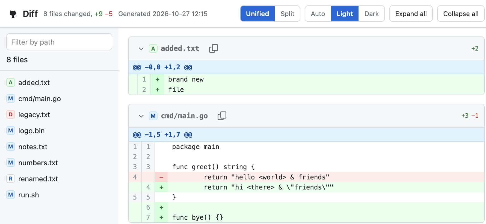

# gitdiff-html

Turns a unified `git diff` into a single, self-contained HTML page that looks
like a GitHub pull request. Send the result to a colleague as an email
attachment, drop it on a wiki, or keep it around next to a review.



## Features

- **Unified / Split view** — switch between the classic single column diff and
  the side by side view; the choice is remembered in `localStorage`.
- **File list on the left** with a filter that matches on the path.
- **Expand all / Collapse all** buttons, plus a chevron on every file.
- **Theme Auto / Light / Dark** — `Auto` follows the system preference and
  updates live when the system switches. The choice is remembered in
  `localStorage`.
- **Copy path button** on every file in the file header.
- **Binary files** are shown as a notice instead of a broken diff.
- **Large diffs** (more than 2000 changed lines in one file) start collapsed.
- **One file, no dependencies** — no fonts, icons or scripts are fetched.

## Usage

```
gitdiff-html [OPTIONS] [FILE]

ARGS:
    <FILE>    Read the diff from FILE instead of standard input

OPTIONS:
    -t, --title <TITLE>    Title of the generated page [default: Diff]
    -o, --output <FILE>    Write the page to FILE instead of standard output
    -i, --input <FILE>     Read the diff from FILE instead of standard input
    -h, --help             Print this help
    -V, --version          Print version information
```

Examples:

```sh
# review the working tree
git diff | gitdiff-html -t "Fix login redirect" > review.html

# review a branch against main
git diff main..feature | gitdiff-html -t "Feature branch" > review.html

# review a saved diff and write the page next to it
gitdiff-html -t "Nightly" -o review.html changes.diff
```

## Development

```sh
cargo test
cargo build --release
```

## License

MIT
